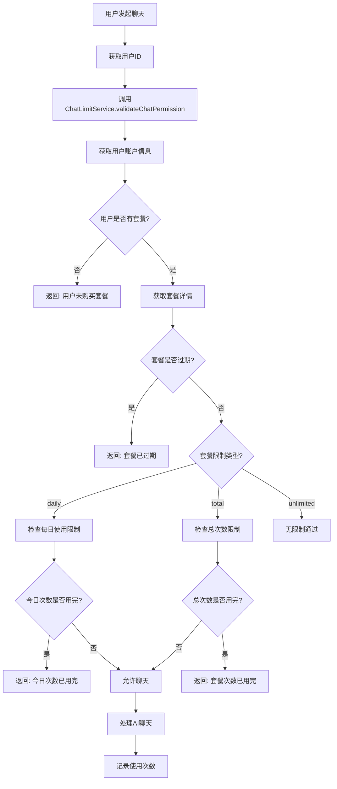

# 套餐管理与检测逻辑流程分析

**文档版本**: v1.0  
**创建时间**: 2025-06-18 03:03:00 (北京时间)  
**作者**: Augment Agent  
**项目**: 金鱼聊天系统 (JinYu Chat)

---

## 📋 目录

1. [系统概述](#系统概述)
2. [套餐管理架构](#套餐管理架构)
3. [逻辑流程详解](#逻辑流程详解)
4. [关键漏洞分析](#关键漏洞分析)
5. [优化建议](#优化建议)
6. [实施方案](#实施方案)

---

## 🎯 系统概述

### 设计目标
金鱼聊天系统采用**套餐制**管理用户的AI聊天权限，支持多种限制模式：
- **每日限制模式** - 每天固定次数（如每天10次、50次）
- **总次数限制模式** - 套餐总次数限制（传统模式）
- **无限制模式** - 企业级无限制使用

### 核心特性
- ✅ 灵活的套餐配置
- ✅ 精确的使用统计
- ✅ 自动过期管理
- ✅ 防重复计费
- ⚠️ **存在关键架构缺陷**

---

## 🏗️ 套餐管理架构

### 数据库设计

#### 1. 套餐表 (t_package)
```sql
CREATE TABLE t_package (
  id bigint PRIMARY KEY,
  package_name varchar(100),           -- 套餐名称
  package_type varchar(50),            -- 套餐类型
  price_usd decimal(10,2),             -- 美元价格
  price_cny decimal(10,2),             -- 人民币价格
  validity_days int DEFAULT 365,       -- 有效期（天）
  chat_count int DEFAULT 1000,         -- 总对话次数
  daily_chat_limit int DEFAULT 10,     -- 每日聊天次数限制 ✨新增
  limit_type varchar(20) DEFAULT 'daily', -- 限制类型 ✨新增
  is_enabled tinyint DEFAULT 1         -- 是否启用
);
```

#### 2. 用户账户表 (t_user_account)
```sql
CREATE TABLE t_user_account (
  id bigint PRIMARY KEY,
  user_id bigint NOT NULL,             -- 用户ID
  package_id bigint,                   -- 当前套餐ID 🔑关键字段
  package_expire_time datetime,        -- 套餐过期时间
  chat_count_remaining int DEFAULT 0,  -- 剩余对话次数
  total_chat_count int DEFAULT 0       -- 总对话次数
);
```

#### 3. 每日使用记录表 (t_user_daily_usage) ✨新增
```sql
CREATE TABLE t_user_daily_usage (
  id bigint PRIMARY KEY,
  user_id bigint NOT NULL,
  package_id bigint NOT NULL,
  usage_date date NOT NULL,            -- 使用日期
  chat_count_used int DEFAULT 0,       -- 已使用次数
  daily_limit int DEFAULT 10,          -- 当日限制
  last_chat_time datetime,
  UNIQUE KEY uk_user_package_date (user_id, package_id, usage_date)
);
```

### 服务架构

```
┌─────────────────┐    ┌──────────────────┐    ┌─────────────────┐
│   ChatApiController  │    │  ChatLimitService    │    │  UserAccountService │
│                 │    │                  │    │                 │
│ 聊天请求入口     │───▶│  权限验证核心     │───▶│  套餐信息管理    │
└─────────────────┘    └──────────────────┘    └─────────────────┘
                              │                          │
                              ▼                          ▼
                    ┌──────────────────┐    ┌─────────────────┐
                    │UserDailyUsageService│    │  PackageService     │
                    │                  │    │                 │
                    │  每日使用统计     │    │  套餐配置管理    │
                    └──────────────────┘    └─────────────────┘
```

---

## 🔄 逻辑流程详解

### 1. 用户聊天请求流程



### 2. 套餐识别逻辑

```java
// 核心逻辑伪代码
public ChatLimitVO validateChatPermission(Long userId) {
    // 1. 获取用户账户信息
    UserAccount userAccount = userAccountService.getUserAccount(userId);
    if (userAccount == null || userAccount.getPackageId() == null) {
        return ChatLimitVO.failed("用户未购买套餐");
    }
    
    // 2. 获取套餐详情
    Package packageInfo = packageService.getPackageById(userAccount.getPackageId());
    
    // 3. 检查套餐状态
    if (packageInfo.getIsEnabled() != 1) {
        return ChatLimitVO.failed("套餐已下架");
    }
    
    // 4. 检查过期时间
    if (userAccount.getPackageExpireTime().isBefore(LocalDateTime.now())) {
        return ChatLimitVO.failed("套餐已过期");
    }
    
    // 5. 根据限制类型验证
    switch (packageInfo.getLimitType()) {
        case "daily":
            return validateDailyLimit(userId, packageInfo);
        case "total":
            return validateTotalLimit(userAccount, packageInfo);
        case "unlimited":
            return ChatLimitVO.success();
    }
}
```

### 3. 每日限制验证流程

```java
private ChatLimitVO validateDailyLimit(Long userId, Package packageInfo) {
    // 1. 获取今日使用记录
    UserDailyUsage todayUsage = userDailyUsageService.getTodayUsage(userId, packageInfo.getId());
    
    // 2. 如果没有记录，创建新记录
    if (todayUsage == null) {
        todayUsage = userDailyUsageService.initTodayUsage(
            userId, packageInfo.getId(), packageInfo.getDailyChatLimit()
        );
    }
    
    // 3. 检查是否达到限制
    if (todayUsage.getChatCountUsed() >= todayUsage.getDailyLimit()) {
        return ChatLimitVO.failed("今日聊天次数已达到限制");
    }
    
    return ChatLimitVO.success();
}
```

---

## 🚨 关键漏洞分析

### 1. 🔴 致命缺陷：UserAccountService 不存在

**问题描述**:
- 代码中多处引用 `UserAccountService.getUserAccount(userId)`
- 但项目中**没有 UserAccountService 接口和实现类**
- 这会导致编译错误和运行时异常

**影响范围**:
- `ChatLimitServiceImpl.validateChatPermission()` ❌
- `UserDailyUsageServiceImpl.canChatToday()` ❌
- 所有套餐验证逻辑无法正常工作 ❌

**风险等级**: 🔴 **致命**

### 2. 🟡 数据一致性问题

**问题描述**:
- `t_user_account` 表存在但无对应实体类
- 缺少用户购买套餐后的账户信息更新逻辑
- 支付成功后没有激活套餐的流程

**影响范围**:
- 用户购买套餐后无法正常使用
- 套餐信息可能不同步

**风险等级**: 🟡 **高**

### 3. 🟡 并发安全问题

**问题描述**:
- 每日使用次数更新没有并发控制
- 多个请求同时到达可能导致超额使用
- 缺少分布式锁机制

**影响范围**:
- 用户可能超出每日限制进行聊天
- 计费不准确

**风险等级**: 🟡 **中**

### 4. 🟢 性能优化空间

**问题描述**:
- 每次聊天都要查询数据库验证权限
- 没有缓存机制
- 过期套餐没有定时清理

**影响范围**:
- 系统响应速度
- 数据库压力

**风险等级**: 🟢 **低**

---

## 💡 优化建议

### 1. 🔧 立即修复 - 创建缺失组件

#### 创建 UserAccount 实体类
```java
@Data
@TableName("t_user_account")
public class UserAccount {
    @TableId(type = IdType.ASSIGN_ID)
    private Long id;
    private Long userId;
    private Long packageId;           // 当前套餐ID
    private LocalDateTime packageExpireTime;
    private Integer chatCountRemaining;
    // ... 其他字段
}
```

#### 创建 UserAccountService
```java
public interface UserAccountService extends IService<UserAccount> {
    UserAccount getUserAccount(Long userId);
    boolean activatePackage(Long userId, Long packageId, Integer validityDays);
    boolean updateUsage(Long userId, Integer usedCount);
}
```

### 2. 🔒 安全加固

#### 添加分布式锁
```java
@RedisLock(key = "chat_limit:#{userId}", waitTime = 3, leaseTime = 5)
public boolean recordChatUsage(Long userId) {
    // 使用分布式锁保证并发安全
}
```

#### 添加缓存机制
```java
@Cacheable(value = "user_package", key = "#userId")
public UserAccount getUserAccount(Long userId) {
    // 缓存用户套餐信息，减少数据库查询
}
```

### 3. 📈 性能优化

#### 批量处理和异步更新
```java
// 异步更新使用记录
@Async
public void updateUsageAsync(Long userId, Long packageId) {
    // 异步更新，提高响应速度
}
```

#### 定时任务清理
```java
@Scheduled(cron = "0 0 2 * * ?") // 每天凌晨2点执行
public void cleanExpiredPackages() {
    // 清理过期套餐和使用记录
}
```

---

## 🚀 实施方案

### 阶段一：紧急修复 (1-2天)
1. ✅ 创建 UserAccount 实体类和 DAO
2. ✅ 实现 UserAccountService 接口和实现类
3. ✅ 修复编译错误，确保系统可运行
4. ✅ 添加支付成功后的套餐激活逻辑

### 阶段二：功能完善 (3-5天)
1. 🔄 添加套餐过期检查和处理
2. 🔄 实现用户套餐信息查询接口
3. 🔄 添加管理员套餐管理功能
4. 🔄 完善错误处理和日志记录

### 阶段三：性能优化 (1周)
1. ⏳ 添加Redis缓存机制
2. ⏳ 实现分布式锁防并发
3. ⏳ 添加定时任务清理机制
4. ⏳ 性能监控和报警

### 阶段四：监控完善 (持续)
1. 📊 添加套餐使用统计
2. 📊 用户行为分析
3. 📊 异常监控和报警
4. 📊 性能指标监控

---

## 📊 总结

当前套餐管理系统的设计理念是**正确的**，支持灵活的每日限制模式，但存在**关键的实现缺陷**：

### ✅ 优势
- 设计架构合理，支持多种限制模式
- 数据库设计完善，支持精确统计
- 代码结构清晰，易于扩展

### ❌ 问题
- **UserAccountService 缺失导致系统无法运行**
- 缺少支付成功后的套餐激活逻辑
- 并发安全和性能优化有待改进

### 🎯 建议
**优先级排序**：
1. 🔴 **立即修复** - 创建缺失的 UserAccountService
2. 🟡 **尽快完善** - 支付流程和套餐激活
3. 🟢 **逐步优化** - 性能和安全加固

修复这些问题后，系统将能够稳定支持**每日10次、50次**等灵活的套餐限制模式，为用户提供良好的使用体验。

---

**文档状态**: 🔄 持续更新  
**下次更新**: 实施方案完成后
