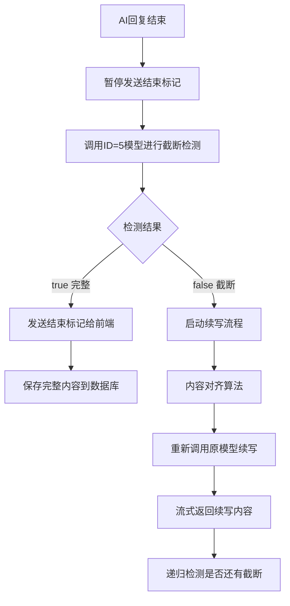

# AI聊天截断检测和续写功能方案

**📅 创建时间**: 2025-07-02 23:03  
**👤 开发人员**: Augment Agent  
**📊 版本**: v1.0  
**🎯 功能**: AI聊天截断检测和自动续写

## 功能概述

在AI聊天接口中增加截断检测机制，当AI回复被截断时自动进行续写，确保用户获得完整的回复内容。该功能排除文件分析接口和标题生成接口。

## 核心流程设计

### 1. 截断检测流程



### 2. 技术实现方案

#### 2.1 截断检测服务

**新增服务接口**: `TruncationDetectionService`

```java
public interface TruncationDetectionService {
    /**
     * 检测内容是否被截断
     * @param content AI回复内容
     * @return true-完整，false-截断
     */
    boolean isContentComplete(String content);
    
    /**
     * 内容对齐算法
     * @param originalContent 原始内容
     * @param continuationContent 续写内容
     * @return 对齐后的完整内容
     */
    String alignContent(String originalContent, String continuationContent);
}
```

#### 2.2 修改ChatServiceImpl

**核心修改点**:
1. `handleStreamCompletion`方法 - 增加截断检测逻辑
2. 新增`detectTruncationAndContinue`方法 - 处理截断检测和续写
3. 新增`continueAiResponse`方法 - 执行续写操作

#### 2.3 排除接口识别

通过以下方式识别需要排除的接口：
- 文件分析接口：检查请求中是否包含`filesId`参数
- 标题生成接口：检查是否为`generateSessionTitle`方法调用
- 其他聊天接口：正常执行截断检测

### 3. 截断检测算法

#### 3.1 检测提示词设计

```
请检查以下内容是否被截断或不完整。如果内容完整，回复"true"；如果内容被截断或不完整，回复"false"。

检测标准：
1. 代码块是否完整闭合
2. 句子是否完整结束
3. 列表、表格等结构是否完整
4. 数学公式是否完整
5. JSON、XML等格式是否完整

内容：
[AI回复内容]
```

#### 3.2 模型配置要求

- 使用ID=5的AI模型进行检测
- 模型必须支持快速响应（非流式）
- 模型需要具备良好的内容理解能力

### 4. 内容对齐算法

#### 4.1 对齐策略

```java
public String alignContent(String original, String continuation) {
    // 1. 查找重叠部分
    String overlap = findOverlap(original, continuation);
    
    // 2. 移除续写内容中的重叠部分
    String cleanContinuation = removeOverlap(continuation, overlap);
    
    // 3. 智能拼接
    return smartConcatenate(original, cleanContinuation);
}
```

#### 4.2 重叠检测算法

- **后缀匹配**: 检查原内容末尾与续写内容开头的重叠
- **模糊匹配**: 处理标点符号、空格差异
- **语义匹配**: 检测意思相同但表达不同的重叠内容

### 5. 实现细节

#### 5.1 聊天次数计算

**重要特性**：续写请求不计入聊天次数
- 原始AI响应计入聊天次数（正常扣减）
- 续写请求不扣减聊天次数
- 通过`ChatResponseDTO.savedByContinuation`标识区分
- 确保用户不会因为AI回复被截断而额外消耗次数

#### 5.2 数据库设计

无需新增表，利用现有消息表结构：
- 截断的消息先保存为临时状态
- 续写完成后更新为最终完整内容
- 增加截断标识字段（可选）

#### 5.2 性能优化

1. **异步检测**: 截断检测不阻塞主流程
2. **缓存机制**: 缓存检测结果避免重复检测
3. **超时控制**: 设置检测和续写的超时时间
4. **重试机制**: 检测失败时的重试策略

#### 5.3 错误处理

```java
// 检测失败处理
if (detectionFailed) {
    // 默认认为内容完整，正常结束
    sendCompletionToFrontend();
    saveToDatabase();
}

// 续写失败处理
if (continuationFailed) {
    // 保存已有内容，添加截断标识
    savePartialContent(originalContent + " [内容可能不完整]");
}
```

### 6. 配置参数

#### 6.1 系统配置

```properties
# 截断检测配置
truncation.detection.enabled=true
truncation.detection.model.id=5
truncation.detection.timeout=10000
truncation.detection.max.retries=3

# 续写配置
continuation.enabled=true
continuation.timeout=30000
continuation.max.attempts=3
continuation.overlap.threshold=0.8
```

#### 6.2 模型要求

- **检测模型(ID=5)**: 快速响应，理解能力强
- **续写模型**: 使用原聊天模型，保持一致性

### 7. 测试策略

#### 7.1 单元测试

- 截断检测算法测试
- 内容对齐算法测试
- 重叠检测算法测试

#### 7.2 集成测试

- 完整流程测试
- 异常情况测试
- 性能压力测试

#### 7.3 测试用例

基于`test.txt`中的测试案例：
1. Python代码块截断
2. HTML标签未闭合
3. JSON数据结构截断
4. SQL查询语句截断
5. Markdown文档截断
6. 数学公式截断
7. 表格数据截断
8. 列表结构截断
9. 代码注释截断
10. 完整内容（不应检测为截断）

### 8. 监控和日志

#### 8.1 关键指标

- 截断检测准确率
- 续写成功率
- 平均检测时间
- 平均续写时间

#### 8.2 日志记录

```java
log.info("截断检测开始，会话ID：{}，内容长度：{}", sessionId, contentLength);
log.info("截断检测结果：{}，耗时：{}ms", isComplete, detectionTime);
log.info("续写操作开始，原内容长度：{}", originalLength);
log.info("续写完成，最终内容长度：{}，总耗时：{}ms", finalLength, totalTime);
```

### 9. 风险评估

#### 9.1 技术风险

- **检测准确性**: 误判可能导致不必要的续写
- **性能影响**: 增加响应时间
- **模型依赖**: 依赖ID=5模型的可用性

#### 9.2 缓解措施

- 建立检测模型的备用方案
- 设置合理的超时和重试机制
- 提供手动开关控制功能

### 10. 实施计划

#### 阶段1: 基础功能开发（3天）
- 截断检测服务实现
- 基础对齐算法实现
- ChatServiceImpl核心逻辑修改

#### 阶段2: 算法优化（2天）
- 重叠检测算法优化
- 性能优化和错误处理
- 配置参数调优

#### 阶段3: 测试和部署（2天）
- 全面测试验证
- 监控指标完善
- 生产环境部署

## 总结

该方案通过智能截断检测和自动续写机制，显著提升用户体验，确保AI回复的完整性。核心创新点包括：

1. **智能检测**: 使用专门模型进行截断检测
2. **无缝续写**: 自动续写被截断的内容
3. **内容对齐**: 智能处理新旧内容的拼接
4. **性能优化**: 异步处理，不影响主流程
5. **容错机制**: 完善的错误处理和降级策略

通过该功能，用户将获得更加完整和连贯的AI对话体验。
