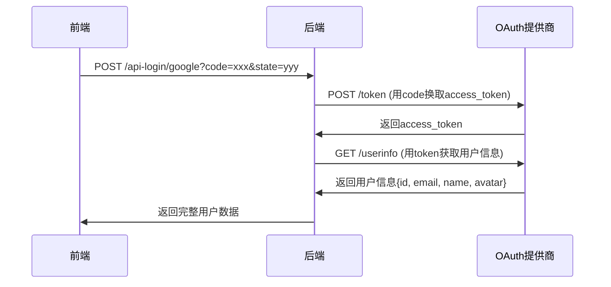

# OAuth2用户信息获取实现

**时间**: 2025-07-17 12:45  
**版本**: v1.1  
**修改类型**: 核心功能实现

## 问题描述

用户发现OAuth2回调流程中缺少了关键步骤：**向OAuth提供商请求用户信息**。当前的`getGoogleUserInfo`和`getGithubUserInfo`方法都是空实现，只抛出"NOT_IMPLEMENTED"异常。

## 解决方案

### 1. 完整的OAuth2用户信息获取流程

实现了完整的OAuth2标准流程：



### 2. 核心实现

#### 2.1 Google OAuth2实现

**Token交换**：
```java
private String exchangeGoogleCodeForToken(String code) {
    String tokenUrl = "https://oauth2.googleapis.com/token";
    
    MultiValueMap<String, String> params = new LinkedMultiValueMap<>();
    params.add("client_id", googleClientId);
    params.add("client_secret", googleClientSecret);
    params.add("code", code);
    params.add("grant_type", "authorization_code");
    params.add("redirect_uri", redirectUri);
    
    // 发送POST请求获取access_token
    ResponseEntity<String> response = restTemplate.postForEntity(tokenUrl, request, String.class);
    JsonNode jsonNode = objectMapper.readTree(response.getBody());
    return jsonNode.get("access_token").asText();
}
```

**用户信息获取**：
```java
private OAuth2UserInfo getGoogleUserInfoByToken(String accessToken) {
    String userInfoUrl = "https://www.googleapis.com/oauth2/v2/userinfo";
    
    HttpHeaders headers = new HttpHeaders();
    headers.setBearerAuth(accessToken);
    
    ResponseEntity<String> response = restTemplate.exchange(
        userInfoUrl, HttpMethod.GET, request, String.class);
    
    JsonNode jsonNode = objectMapper.readTree(response.getBody());
    
    OAuth2UserInfo userInfo = new OAuth2UserInfo();
    userInfo.setProvider("google");
    userInfo.setId(jsonNode.get("id").asText());
    userInfo.setEmail(jsonNode.get("email").asText());
    userInfo.setName(jsonNode.get("name").asText());
    userInfo.setAvatar(jsonNode.get("picture").asText());
    
    return userInfo;
}
```

#### 2.2 GitHub OAuth2实现

**Token交换**：
```java
private String exchangeGithubCodeForToken(String code) {
    String tokenUrl = "https://github.com/login/oauth/access_token";
    
    HttpHeaders headers = new HttpHeaders();
    headers.set("Accept", "application/json"); // GitHub需要这个头
    
    // GitHub返回JSON格式的token响应
    ResponseEntity<String> response = restTemplate.postForEntity(tokenUrl, request, String.class);
    JsonNode jsonNode = objectMapper.readTree(response.getBody());
    
    // 检查错误
    if (jsonNode.has("error")) {
        throw new OAuth2Exception("GITHUB_TOKEN_ERROR", 
            "GitHub token错误: " + jsonNode.get("error").asText());
    }
    
    return jsonNode.get("access_token").asText();
}
```

**用户信息获取**：
```java
private OAuth2UserInfo getGithubUserInfoByToken(String accessToken) {
    String userInfoUrl = "https://api.github.com/user";
    
    HttpHeaders headers = new HttpHeaders();
    headers.setBearerAuth(accessToken);
    headers.set("Accept", "application/vnd.github.v3+json");
    
    ResponseEntity<String> response = restTemplate.exchange(
        userInfoUrl, HttpMethod.GET, request, String.class);
    
    JsonNode jsonNode = objectMapper.readTree(response.getBody());
    
    OAuth2UserInfo userInfo = new OAuth2UserInfo();
    userInfo.setProvider("github");
    userInfo.setId(jsonNode.get("id").asText());
    userInfo.setName(jsonNode.get("name").asText() != null ? 
        jsonNode.get("name").asText() : jsonNode.get("login").asText());
    userInfo.setAvatar(jsonNode.get("avatar_url").asText());
    
    // GitHub需要单独获取邮箱
    String email = getGithubUserEmail(accessToken);
    userInfo.setEmail(email);
    
    return userInfo;
}
```

**GitHub邮箱获取**：
```java
private String getGithubUserEmail(String accessToken) {
    String emailUrl = "https://api.github.com/user/emails";
    
    ResponseEntity<String> response = restTemplate.exchange(
        emailUrl, HttpMethod.GET, request, String.class);
    
    JsonNode emailsArray = objectMapper.readTree(response.getBody());
    
    // 优先返回主邮箱且已验证的邮箱
    for (JsonNode emailNode : emailsArray) {
        if (emailNode.get("primary").asBoolean() && 
            emailNode.get("verified").asBoolean()) {
            return emailNode.get("email").asText();
        }
    }
    
    // 如果没有主邮箱，返回第一个验证的邮箱
    for (JsonNode emailNode : emailsArray) {
        if (emailNode.get("verified").asBoolean()) {
            return emailNode.get("email").asText();
        }
    }
    
    return null;
}
```

### 3. 配置更新

#### 3.1 application.yml配置
```yaml
oauth2:
  providers:
    google:
      client-id: ${GOOGLE_CLIENT_ID:}
      client-secret: ${GOOGLE_CLIENT_SECRET:}
      authorization-uri: https://accounts.google.com/o/oauth2/v2/auth
      token-uri: https://oauth2.googleapis.com/token
      user-info-uri: https://www.googleapis.com/oauth2/v2/userinfo
      scope: openid,email,profile
      redirect-uri: http://localhost:8080/api/auth/oauth2/callback/google
    
    github:
      client-id: ${GITHUB_CLIENT_ID:}
      client-secret: ${GITHUB_CLIENT_SECRET:}
      authorization-uri: https://github.com/login/oauth/authorize
      token-uri: https://github.com/login/oauth/access_token
      user-info-uri: https://api.github.com/user
      scope: user:email
      redirect-uri: http://localhost:8080/api/auth/oauth2/callback/github
```

#### 3.2 依赖注入
```java
@Autowired
private RestTemplate restTemplate;  // 已在WebClientConfig中配置

@Autowired
private ObjectMapper objectMapper;  // Spring Boot自动配置

@Value("${oauth2.providers.google.client-secret:}")
private String googleClientSecret;

@Value("${oauth2.providers.github.client-secret:}")
private String githubClientSecret;
```

### 4. 错误处理

#### 4.1 完整的异常处理
- **Token交换失败**：OAuth2Exception with "TOKEN_EXCHANGE_ERROR"
- **用户信息请求失败**：OAuth2Exception with "USER_INFO_REQUEST_ERROR"
- **GitHub特定错误**：解析error字段并返回详细错误信息
- **网络异常**：统一包装为OAuth2Exception

#### 4.2 日志记录
- **DEBUG级别**：记录详细的请求过程
- **INFO级别**：记录成功获取用户信息
- **ERROR级别**：记录异常和错误详情

### 5. 安全考虑

#### 5.1 敏感信息保护
- **Code参数**：日志中只显示前10个字符
- **Access Token**：不记录到日志中
- **Client Secret**：通过环境变量配置

#### 5.2 请求头设置
- **Google**：标准Bearer认证
- **GitHub**：需要Accept头指定API版本

### 6. 测试建议

#### 6.1 环境变量设置
```bash
export GOOGLE_CLIENT_ID="your-google-client-id"
export GOOGLE_CLIENT_SECRET="your-google-client-secret"
export GITHUB_CLIENT_ID="your-github-client-id"
export GITHUB_CLIENT_SECRET="your-github-client-secret"
```

#### 6.2 测试流程
1. **获取授权URL**：`GET /auth/oauth2/login/google`
2. **用户授权**：跳转到Google/GitHub授权页面
3. **API登录**：`POST /auth/oauth2/api-login/google`
4. **验证响应**：检查返回的用户数据完整性

### 7. 影响范围

#### 7.1 新增功能
- ✅ 完整的Google OAuth2用户信息获取
- ✅ 完整的GitHub OAuth2用户信息获取
- ✅ GitHub邮箱单独获取逻辑
- ✅ 完整的错误处理和日志记录

#### 7.2 配置文件
- 修改：`src/main/resources/application.yml`
- 修改：`src/main/java/com/instser/chat/service/impl/OAuth2ServiceImpl.java`

#### 7.3 依赖关系
- 使用现有的RestTemplate配置
- 使用Spring Boot自动配置的ObjectMapper
- 无需添加新的Maven依赖

## 后续工作

1. **OAuth应用注册**：在Google和GitHub注册OAuth应用
2. **环境变量配置**：设置client-id和client-secret
3. **前端集成测试**：验证完整的登录流程
4. **生产环境配置**：更新重定向URI为生产域名
