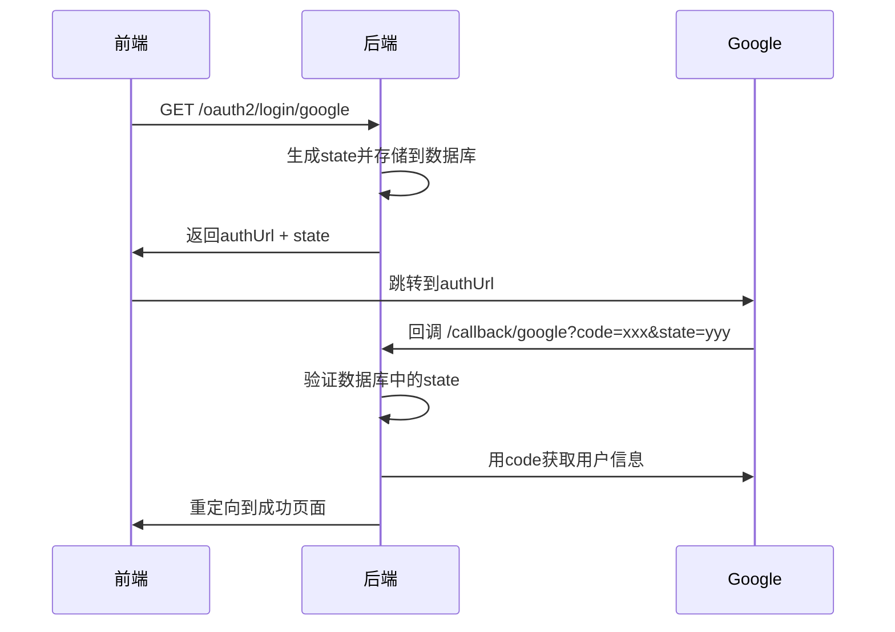
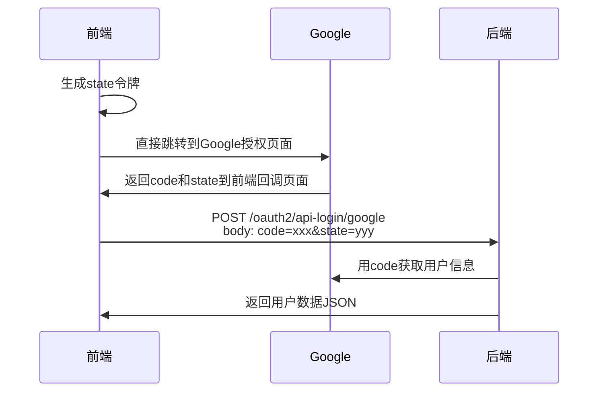

# 前端主导OAuth2流程适配

**时间**: 2025-07-17 13:00  
**版本**: v1.2  
**修改类型**: 流程优化

## 问题描述

用户澄清了实际的OAuth2流程：**前端自己处理Google跳转和登录，获取到用户的code后返回给后端。并且现在state也由前端生成，和code一起返回给后端。**

这是一种更现代的SPA应用常用的前端主导OAuth2实现方式。

## 流程对比

### 原有流程（后端主导）


### 新流程（前端主导）


## 核心修改

### 1. 移除State验证

**原因**：前端生成的state不在后端数据库中，会导致验证失败。

**修改前**：
```java
// 2. 验证状态令牌
if (!oauth2Service.validateState(state, provider, clientIp)) {
    return ResponseEntity.ok(Result.failed("安全验证失败，请重新登录"));
}
```

**修改后**：
```java
// 2. 前端主导流程，跳过state验证（前端已处理CSRF保护）
log.debug("【OAuth2处理】前端主导流程，跳过state验证，state: {}", state);
```

### 2. 简化配置端点

**原端点**：`GET /auth/oauth2/login/{provider}` - 生成授权URL
**新端点**：`GET /auth/oauth2/config/{provider}` - 返回配置信息

**修改内容**：
```java
@GetMapping("/config/{provider}")
@Operation(summary = "获取OAuth2配置信息", description = "获取指定提供商的OAuth2配置信息供前端使用")
public ResponseEntity<Result<OAuth2LoginResponse>> getOAuth2Config(
        @PathVariable String provider, HttpServletRequest request) {
    
    // 返回OAuth2配置信息供前端使用
    OAuth2LoginResponse response = OAuth2LoginResponse.builder()
        .provider(provider)
        .clientId(getClientIdForProvider(provider))
        .build();
        
    return ResponseEntity.ok(Result.success(response, "获取OAuth2配置成功"));
}
```

### 3. 扩展OAuth2LoginResponse

添加了前端需要的配置字段：
```java
@Data
@Builder
public class OAuth2LoginResponse {
    private String authUrl;        // 授权URL（后端主导时使用）
    private String provider;       // OAuth提供商
    private String clientId;       // 客户端ID（前端主导时使用）
    private String authorizationUri; // 授权URI（前端主导时使用）
    private String redirectUri;    // 重定向URI（前端主导时使用）
    private String scope;          // 权限范围（前端主导时使用）
    private String state;          // 状态令牌
    private Integer expiresIn;     // 过期时间
}
```

### 4. 参数调整

**API登录端点参数调整**：
```java
@PostMapping("/api-login/{provider}")
public ResponseEntity<Result<UserVO>> handleApiLogin(
        @PathVariable String provider,
        @RequestParam String code,
        @RequestParam(required = false) String state,  // 改为可选
        @RequestParam(required = false) String error,
        HttpServletRequest request,
        HttpServletResponse response) {
```

## 前端集成示例

### 方式1：使用配置端点（推荐）
```javascript
// 1. 获取OAuth2配置
const configResponse = await fetch('/auth/oauth2/config/google');
const config = configResponse.data;

// 2. 前端构建授权URL
const state = generateRandomState(); // 前端生成state
const authUrl = `https://accounts.google.com/o/oauth2/v2/auth?` +
  `client_id=${config.clientId}&` +
  `redirect_uri=${encodeURIComponent('http://localhost:3000/oauth/callback')}&` +
  `response_type=code&` +
  `scope=openid email profile&` +
  `state=${state}`;

// 3. 跳转授权
window.location.href = authUrl;

// 4. 在回调页面处理
const urlParams = new URLSearchParams(window.location.search);
const code = urlParams.get('code');
const returnedState = urlParams.get('state');

// 验证state（前端CSRF保护）
if (returnedState !== state) {
  throw new Error('State验证失败');
}

// 5. 发送到后端
const loginResponse = await fetch('/auth/oauth2/api-login/google', {
  method: 'POST',
  headers: { 'Content-Type': 'application/x-www-form-urlencoded' },
  body: `code=${code}&state=${state}`
});

const result = await loginResponse.json();
if (result.code === 200) {
  // 登录成功，获取用户数据
  setUser(result.data);
  navigate('/dashboard');
}
```

### 方式2：直接使用（无需配置端点）
```javascript
// 前端直接使用已知的Google配置
const clientId = 'your-google-client-id';
const state = generateRandomState();
const authUrl = `https://accounts.google.com/o/oauth2/v2/auth?` +
  `client_id=${clientId}&` +
  `redirect_uri=${encodeURIComponent('http://localhost:3000/oauth/callback')}&` +
  `response_type=code&` +
  `scope=openid email profile&` +
  `state=${state}`;

// 其余流程相同...
```

## 安全考虑

### 1. CSRF保护
- **前端责任**：前端生成state并验证返回的state
- **后端简化**：不再验证state，专注于用户信息获取

### 2. 配置安全
- **Client ID**：可以公开，通过配置端点返回
- **Client Secret**：仍然保密，只在后端使用

### 3. 重定向URI验证
- **OAuth提供商验证**：Google/GitHub会验证重定向URI
- **前端配置**：确保重定向URI与OAuth应用配置一致

## 兼容性

### 1. 向后兼容
- ✅ 保留原有的`GET /auth/oauth2/callback/{provider}`重定向端点
- ✅ 保留原有的`POST /auth/oauth2/api-login/{provider}`API端点
- ✅ 新增`GET /auth/oauth2/config/{provider}`配置端点

### 2. 灵活支持
- **前端主导**：使用新的config端点和api-login端点
- **后端主导**：仍可使用原有的login端点和callback端点

## 配置要求

### 1. 环境变量
```bash
# Google OAuth2
export GOOGLE_CLIENT_ID="your-google-client-id"
export GOOGLE_CLIENT_SECRET="your-google-client-secret"

# GitHub OAuth2  
export GITHUB_CLIENT_ID="your-github-client-id"
export GITHUB_CLIENT_SECRET="your-github-client-secret"
```

### 2. OAuth应用配置
**Google Console**：
- 授权重定向URI：`http://localhost:3000/oauth/callback`
- 授权域：`localhost`

**GitHub Settings**：
- Authorization callback URL：`http://localhost:3000/oauth/callback`

## 优势

### 1. 前端优势
- ✅ **完全控制**：前端控制整个OAuth流程
- ✅ **用户体验**：无需等待后端重定向
- ✅ **状态管理**：前端直接获取用户数据
- ✅ **错误处理**：统一的错误处理机制

### 2. 后端优势
- ✅ **简化逻辑**：专注于用户信息获取和处理
- ✅ **无状态**：不需要存储和验证state
- ✅ **API化**：标准的RESTful API响应

### 3. 安全优势
- ✅ **分离关注点**：前端处理CSRF，后端处理认证
- ✅ **减少攻击面**：后端不暴露授权URL生成逻辑
- ✅ **标准实现**：符合现代SPA应用的OAuth2最佳实践

## 测试建议

1. **配置端点测试**：`GET /auth/oauth2/config/google`
2. **完整流程测试**：前端生成state → Google授权 → API登录
3. **错误场景测试**：无效code、网络错误等
4. **兼容性测试**：确保原有重定向方式仍然工作

这种前端主导的OAuth2流程更适合现代SPA应用，提供了更好的用户体验和开发体验！
