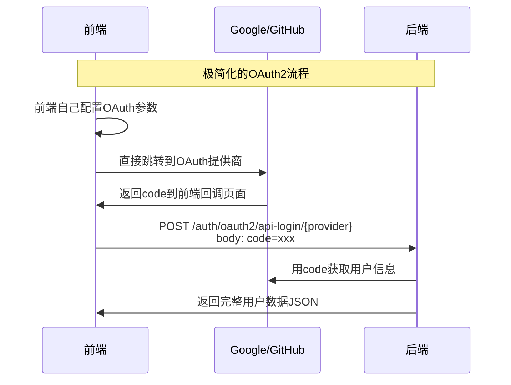

# OAuth2流程最终简化

**时间**: 2025-07-17 13:15  
**版本**: v1.3  
**修改类型**: 流程简化

## 需求澄清

用户明确了最终需求：
1. **不需要保留兼容配置** - 移除所有旧的配置端点
2. **前端不需要获取OAuth2配置** - 前端自己处理所有OAuth配置
3. **后端只需要等待前端发送的附带code的请求然后处理就行** - 极简化的后端处理

## 最终简化流程



## 核心简化

### 1. 移除的功能
- ❌ `GET /auth/oauth2/login/{provider}` - 获取授权URL端点
- ❌ `GET /auth/oauth2/config/{provider}` - 获取配置信息端点  
- ❌ `GET /auth/oauth2/callback/{provider}` - 重定向回调端点
- ❌ State验证逻辑
- ❌ OAuth2SecurityUtil依赖
- ❌ 客户端ID配置注入
- ❌ OAuth2LoginResponse的配置字段

### 2. 保留的功能
- ✅ `POST /auth/oauth2/api-login/{provider}` - API登录端点（简化版）
- ✅ OAuth2用户信息获取逻辑
- ✅ 用户登录/注册处理
- ✅ JWT令牌生成和Cookie设置
- ✅ 完整的用户数据返回
- ✅ 绑定/解绑功能（如需要）

### 3. 简化的API端点

```java
@PostMapping("/api-login/{provider}")
@Operation(summary = "OAuth2 API登录", description = "处理前端主导的OAuth2登录并返回用户数据")
public ResponseEntity<Result<UserVO>> handleApiLogin(
        @PathVariable String provider,
        @RequestParam String code,
        @RequestParam(required = false) String error,
        HttpServletRequest request,
        HttpServletResponse response) {
    
    // 1. 处理OAuth错误
    if (StringUtils.hasText(error)) {
        return ResponseEntity.ok(Result.failed(getOAuthErrorMessage(error)));
    }
    
    // 2. 直接获取用户信息（无state验证）
    OAuth2UserInfo userInfo = oauth2Service.getUserInfo(provider, code);
    
    // 3. 处理用户登录/注册
    OAuth2LoginResult loginResult = oauth2Service.processLogin(userInfo, clientIp, userAgent);
    
    // 4. 生成JWT并返回用户数据
    String token = jwtUtil.generateToken(loginResult.getUser());
    response.addHeader(HttpHeaders.SET_COOKIE, jwtUtil.createAuthCookie(token).toString());
    
    UserVO userVO = buildUserVO(loginResult.getUser());
    String message = loginResult.isNewUser() ? "注册并登录成功" : "登录成功";
    
    return ResponseEntity.ok(Result.success(userVO, message));
}
```

## 前端集成示例

### 完全自主的前端实现

```javascript
// 前端完全自主处理OAuth2流程

// 1. 前端自己配置OAuth参数
const GOOGLE_CONFIG = {
  clientId: 'your-google-client-id',
  redirectUri: 'http://localhost:3000/oauth/callback',
  scope: 'openid email profile',
  authUrl: 'https://accounts.google.com/o/oauth2/v2/auth'
};

const GITHUB_CONFIG = {
  clientId: 'your-github-client-id', 
  redirectUri: 'http://localhost:3000/oauth/callback',
  scope: 'user:email',
  authUrl: 'https://github.com/login/oauth/authorize'
};

// 2. 生成授权URL并跳转
function loginWithGoogle() {
  const state = Math.random().toString(36).substring(2, 15);
  localStorage.setItem('oauth_state', state);
  
  const authUrl = `${GOOGLE_CONFIG.authUrl}?` +
    `client_id=${GOOGLE_CONFIG.clientId}&` +
    `redirect_uri=${encodeURIComponent(GOOGLE_CONFIG.redirectUri)}&` +
    `response_type=code&` +
    `scope=${encodeURIComponent(GOOGLE_CONFIG.scope)}&` +
    `state=${state}`;
  
  window.location.href = authUrl;
}

function loginWithGitHub() {
  const state = Math.random().toString(36).substring(2, 15);
  localStorage.setItem('oauth_state', state);
  
  const authUrl = `${GITHUB_CONFIG.authUrl}?` +
    `client_id=${GITHUB_CONFIG.clientId}&` +
    `redirect_uri=${encodeURIComponent(GITHUB_CONFIG.redirectUri)}&` +
    `scope=${encodeURIComponent(GITHUB_CONFIG.scope)}&` +
    `state=${state}`;
  
  window.location.href = authUrl;
}

// 3. 在回调页面处理授权结果
async function handleOAuthCallback() {
  const urlParams = new URLSearchParams(window.location.search);
  const code = urlParams.get('code');
  const state = urlParams.get('state');
  const error = urlParams.get('error');
  
  // 前端验证state（可选）
  const savedState = localStorage.getItem('oauth_state');
  if (state !== savedState) {
    throw new Error('State验证失败');
  }
  
  if (error) {
    throw new Error(`OAuth错误: ${error}`);
  }
  
  if (!code) {
    throw new Error('未获取到授权码');
  }
  
  // 4. 发送code到后端
  const provider = getProviderFromUrl(); // 从URL或其他方式确定provider
  
  try {
    const response = await fetch(`/auth/oauth2/api-login/${provider}`, {
      method: 'POST',
      headers: { 'Content-Type': 'application/x-www-form-urlencoded' },
      body: `code=${code}`
    });
    
    const result = await response.json();
    
    if (result.code === 200) {
      // 登录成功
      console.log('用户信息:', result.data);
      
      // 清理临时数据
      localStorage.removeItem('oauth_state');
      
      // 更新应用状态
      setUser(result.data);
      navigate('/dashboard');
    } else {
      throw new Error(result.message || '登录失败');
    }
  } catch (error) {
    console.error('OAuth登录失败:', error);
    navigate('/login?error=' + encodeURIComponent(error.message));
  }
}

function getProviderFromUrl() {
  // 根据当前URL或其他方式确定是Google还是GitHub
  // 例如从URL参数、localStorage或其他状态管理中获取
  return new URLSearchParams(window.location.search).get('provider') || 'google';
}
```

## 后端配置

### 1. 环境变量（仅后端需要）
```bash
# 后端用于获取用户信息的密钥
export GOOGLE_CLIENT_SECRET="your-google-client-secret"
export GITHUB_CLIENT_SECRET="your-github-client-secret"
```

### 2. application.yml简化配置
```yaml
oauth2:
  providers:
    google:
      client-secret: ${GOOGLE_CLIENT_SECRET:}
    github:
      client-secret: ${GITHUB_CLIENT_SECRET:}
```

## API响应格式

### 成功响应
```json
{
  "code": 200,
  "message": "登录成功",
  "data": {
    "id": "123",
    "username": "user",
    "email": "user@example.com",
    "avatar": "https://...",
    "role": "USER",
    "status": 1,
    "lastLoginTime": "2025-07-17T13:15:00",
    "createdTime": "2025-07-17T10:00:00", 
    "updateTime": "2025-07-17T13:15:00",
    "packageName": "基础套餐",
    "packageId": "1"
  }
}
```

### 错误响应
```json
{
  "code": 400,
  "message": "获取用户信息失败: invalid_grant",
  "data": null
}
```

## 优势

### 1. 极简化
- ✅ **后端专注**：只处理用户信息获取和认证
- ✅ **前端自主**：完全控制OAuth流程和用户体验
- ✅ **无状态**：后端无需存储任何OAuth状态

### 2. 高性能
- ✅ **减少请求**：前端不需要额外的配置请求
- ✅ **简化逻辑**：移除复杂的state验证和存储
- ✅ **直接处理**：一个API调用完成整个登录流程

### 3. 易维护
- ✅ **代码简洁**：移除大量不必要的代码
- ✅ **职责清晰**：前端负责OAuth流程，后端负责用户处理
- ✅ **配置简单**：最少的配置项

## 安全考虑

### 1. 前端安全
- **State验证**：前端可选择性验证state防CSRF
- **HTTPS**：生产环境必须使用HTTPS
- **重定向URI验证**：OAuth提供商会验证重定向URI

### 2. 后端安全
- **Code验证**：OAuth提供商验证authorization code的有效性
- **Client Secret保护**：只在后端使用，不暴露给前端
- **用户信息验证**：从可信的OAuth提供商获取用户信息

这种极简化的实现既满足了功能需求，又保持了代码的简洁性和可维护性！
