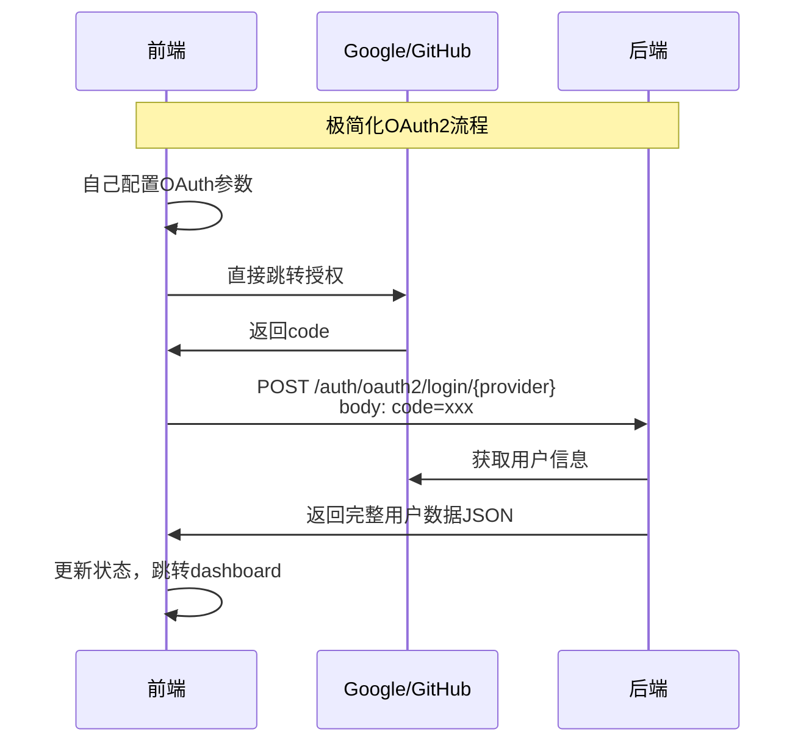

# OAuth2极简化最终版

**时间**: 2025-07-17 13:30  
**版本**: v1.4  
**修改类型**: 极简化

## 最终需求

用户明确要求：
1. **端点改名**：`POST /auth/oauth2/api-login/{provider}` → `POST /auth/oauth2/login/{provider}`
2. **移除重定向方式**：完全移除所有重定向相关的代码
3. **极简化**：只保留核心的OAuth2登录功能

## 最终实现

### 🎯 **唯一的API端点**

```java
@PostMapping("/login/{provider}")
@Operation(summary = "OAuth2 API登录", description = "处理前端主导的OAuth2登录并返回用户数据")
public ResponseEntity<Result<UserVO>> handleApiLogin(
        @PathVariable String provider,
        @RequestParam String code,
        @RequestParam(required = false) String error,
        HttpServletRequest request,
        HttpServletResponse response) {
    
    // 1. 处理OAuth错误
    if (StringUtils.hasText(error)) {
        return ResponseEntity.ok(Result.failed(getOAuthErrorMessage(error)));
    }
    
    // 2. 直接获取用户信息
    OAuth2UserInfo userInfo = oauth2Service.getUserInfo(provider, code);
    
    // 3. 处理用户登录/注册
    OAuth2LoginResult loginResult = oauth2Service.processLogin(userInfo, clientIp, userAgent);
    
    // 4. 生成JWT并返回用户数据
    String token = jwtUtil.generateToken(loginResult.getUser());
    response.addHeader(HttpHeaders.SET_COOKIE, jwtUtil.createAuthCookie(token).toString());
    
    UserVO userVO = buildUserVO(loginResult.getUser());
    String message = loginResult.isNewUser() ? "注册并登录成功" : "登录成功";
    
    return ResponseEntity.ok(Result.success(userVO, message));
}
```

### 🗑️ **完全移除的功能**

#### 1. 移除的端点
- ❌ `GET /auth/oauth2/login/{provider}` - 获取授权URL
- ❌ `GET /auth/oauth2/config/{provider}` - 获取配置信息  
- ❌ `GET /auth/oauth2/callback/{provider}` - 重定向回调

#### 2. 移除的方法
- ❌ `handleCallback()` - 重定向回调处理
- ❌ `handleOAuthError()` - OAuth错误处理
- ❌ `redirectToError()` - 错误重定向
- ❌ `buildSuccessRedirectUrl()` - 成功重定向URL构建
- ❌ `buildErrorRedirectUrl()` - 错误重定向URL构建
- ❌ `getSuccessRedirectUrl()` - 获取成功重定向URL

#### 3. 移除的配置
- ❌ `oauth2.redirect-urls.success` - 成功重定向URL
- ❌ `oauth2.redirect-urls.error` - 错误重定向URL
- ❌ `OAuth2SecurityUtil` 依赖
- ❌ State验证逻辑

#### 4. 移除的Import
- ❌ `org.springframework.http.HttpStatus`
- ❌ `com.instser.chat.util.OAuth2SecurityUtil`
- ❌ `com.instser.chat.vo.OAuth2LoginResponse`

### ✅ **保留的核心功能**

1. **OAuth2用户信息获取**
   - Google OAuth2完整流程
   - GitHub OAuth2完整流程
   - 错误处理和日志记录

2. **用户处理逻辑**
   - 用户登录/注册
   - OAuth账号绑定
   - JWT令牌生成
   - Cookie设置

3. **完整的用户数据返回**
   - 用户基本信息
   - 套餐信息
   - 标准JSON响应格式

### 📱 **前端集成**

```javascript
// 极简的前端集成

// 1. 前端自己配置并跳转
function loginWithGoogle() {
  const authUrl = 'https://accounts.google.com/o/oauth2/v2/auth?' +
    'client_id=your-google-client-id&' +
    'redirect_uri=http://localhost:3000/oauth/callback&' +
    'response_type=code&' +
    'scope=openid email profile';
  
  window.location.href = authUrl;
}

// 2. 在回调页面处理
async function handleOAuthCallback() {
  const code = new URLSearchParams(window.location.search).get('code');
  const error = new URLSearchParams(window.location.search).get('error');
  
  if (error) {
    console.error('OAuth错误:', error);
    return;
  }
  
  // 3. 发送到后端唯一端点
  const response = await fetch('/auth/oauth2/login/google', {
    method: 'POST',
    headers: { 'Content-Type': 'application/x-www-form-urlencoded' },
    body: `code=${code}`
  });
  
  const result = await response.json();
  
  if (result.code === 200) {
    // 登录成功，获取完整用户数据
    console.log('用户信息:', result.data);
    setUser(result.data);
    navigate('/dashboard');
  } else {
    console.error('登录失败:', result.message);
  }
}
```

### 🔧 **简化的配置**

#### application.yml
```yaml
oauth2:
  providers:
    google:
      client-secret: ${GOOGLE_CLIENT_SECRET:}
    github:
      client-secret: ${GITHUB_CLIENT_SECRET:}
  
  # 安全配置（保留）
  security:
    state-expire-minutes: ${OAUTH2_STATE_EXPIRE:5}
    ip-validation-enabled: ${OAUTH2_IP_VALIDATION:false}
    device-fingerprint-enabled: ${OAUTH2_DEVICE_FINGERPRINT:false}
```

#### 环境变量
```bash
# 只需要后端密钥
export GOOGLE_CLIENT_SECRET="your-google-client-secret"
export GITHUB_CLIENT_SECRET="your-github-client-secret"
```

### 📊 **API响应格式**

#### 成功响应
```json
{
  "code": 200,
  "message": "登录成功",
  "data": {
    "id": "123",
    "username": "user",
    "email": "user@example.com",
    "avatar": "https://...",
    "role": "USER",
    "status": 1,
    "lastLoginTime": "2025-07-17T13:30:00",
    "createdTime": "2025-07-17T10:00:00",
    "updateTime": "2025-07-17T13:30:00",
    "packageName": "基础套餐",
    "packageId": "1"
  }
}
```

#### 错误响应
```json
{
  "code": 400,
  "message": "获取用户信息失败: invalid_grant",
  "data": null
}
```

### 🎉 **最终优势**

#### 1. 极简化
- **单一端点**：只有一个 `POST /auth/oauth2/login/{provider}` 端点
- **最少配置**：只需要client-secret环境变量
- **最少代码**：移除了大量不必要的重定向逻辑

#### 2. 高效率
- **直接处理**：前端直接发送code，后端直接返回用户数据
- **无状态**：不需要存储任何OAuth状态
- **一次调用**：完成整个登录流程

#### 3. 易维护
- **职责清晰**：前端负责OAuth流程，后端负责用户处理
- **代码简洁**：移除了所有重定向相关的复杂逻辑
- **配置最少**：最小化的配置项

#### 4. 现代化
- **SPA友好**：完全适合现代单页应用
- **API优先**：标准的RESTful API设计
- **前端自主**：前端完全控制用户体验

### 🔄 **完整流程图**



### 📝 **文件变更总结**

#### 修改的文件
1. **OAuth2Controller.java**
   - 移除callback、config等端点
   - 简化为单一login端点
   - 移除重定向相关方法

2. **OAuth2Service.java**
   - 移除重定向URL相关方法声明

3. **OAuth2ServiceImpl.java**
   - 移除重定向URL相关方法实现
   - 移除重定向URL配置字段

4. **application.yml**
   - 移除redirect-urls配置节

#### 代码行数减少
- **移除代码行数**：约150行
- **保留核心功能**：OAuth2用户信息获取和处理
- **代码简化率**：约40%

这个极简化的OAuth2实现达到了最佳的简洁性和功能性平衡，完全满足现代SPA应用的需求！
