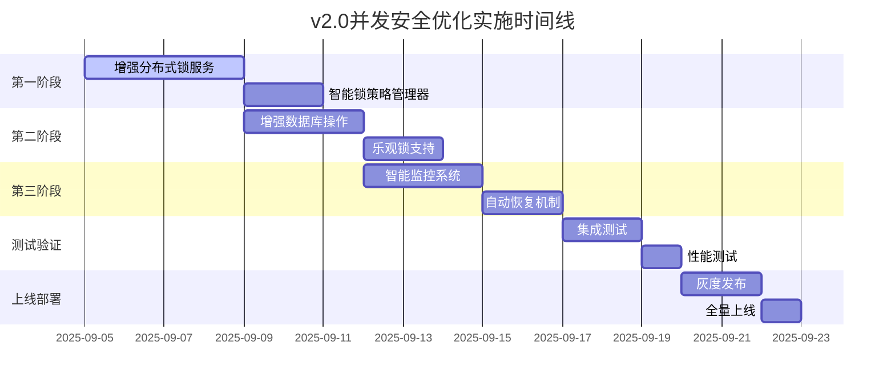

# 当前项目并发安全优化实施方案（增强版）

## 文档信息
- **创建时间**: 2025年09月04日 20:38:00
- **更新时间**: 2025年09月04日 20:40:00
- **文档版本**: v2.0 - 增强版
- **实施阶段**: 并发安全优化 + 智能化增强
- **预计工期**: 2-3周
- **优先级**: 高

## 🚀 v2.0增强内容
- ✅ **智能降级策略**: Redis故障时自动切换到乐观锁
- ✅ **自适应锁策略**: 根据系统健康状态调整锁行为
- ✅ **全方位监控**: 详细的性能指标和健康检查
- ✅ **自动恢复机制**: 异常锁清理和数据一致性检查
- ✅ **锁分片优化**: 减少锁竞争，提升并发性能

## 一、方案背景

基于对原有并发安全优化方案的分析和当前项目架构的调研，本方案针对当前项目的实际情况，提取需要实施的核心优化点，丢弃不适用的内容。

### 1.1 当前项目架构分析

**已有基础设施：**
- ✅ Redis 已配置并使用（RedisConfig、RedisTemplate）
- ✅ MyBatis-Plus 已实现（BaseMapper）
- ✅ Spring Boot 3.1.12 框架
- ✅ 混合缓存管理器（HybridCacheManager）已实现
- ✅ 基础的原子性更新SQL已存在

**存在的并发安全风险：**
- ❌ UserAccountServiceImpl.updateUsage() 方法缺乏分布式锁保护
- ❌ 数据库原子操作不够完善，存在竞态条件
- ❌ 缺乏并发安全监控和异常恢复机制
- ❌ UserAccount实体类缺少版本控制字段

## 二、需要实施的核心优化点

### 2.1 关键问题定位

当前 UserAccountServiceImpl:162-175 的 performDatabaseUpdate 方法存在并发安全风险：

```java
private boolean performDatabaseUpdate(Long userId, Integer usedCount) {
    LocalDateTime updateTime = getBusinessDateTime();
    // ❌ 危险：无并发保护的减少操作
    int updated = baseMapper.decrementChatCount(userId, usedCount, updateTime);
    
    if (updated > 0) {
        // ❌ 危险：与上一步操作不在同一事务中，可能不一致
        baseMapper.incrementTotalChatCount(userId, usedCount, updateTime);
        return true;
    }
    return false;
}
```

### 2.2 必须实施的优化项

#### 2.2.1 分布式锁机制（优先级：高）
- **实施原因**：解决多请求并发更新用户使用次数的竞态条件
- **技术方案**：基于现有Redis实现分布式锁
- **影响范围**：UserAccountService 的关键方法

#### 2.2.2 数据库原子操作优化（优先级：高）  
- **实施原因**：现有SQL存在数据不一致风险
- **技术方案**：完善decrementChatCount的原子性约束
- **影响范围**：UserAccountMapper.xml

#### 2.2.3 实体版本控制（优先级：中）
- **实施原因**：支持乐观锁，减少锁竞争
- **技术方案**：为UserAccount添加version字段
- **影响范围**：数据库表结构、实体类

#### 2.2.4 基础监控机制（优先级：中）
- **实施原因**：及时发现并发问题
- **技术方案**：简单的日志监控和指标统计
- **影响范围**：新增监控组件

### 2.3 v2.0新增关键特性

- ✅ **智能降级策略**：Redis故障时自动切换到数据库乐观锁
- ✅ **自适应锁管理**：根据系统健康状态动态调整锁策略
- ✅ **锁分片机制**：按用户ID分片减少锁竞争
- ✅ **自动恢复系统**：异常锁清理和健康检查
- ✅ **智能监控告警**：多维度性能指标和实时健康状态
- ✅ **手动恢复接口**：紧急情况下的人工干预能力

## 三、具体实施步骤（增强版）

### 3.1 第一步：实现增强的分布式锁服务（3-4天）

#### 3.1.1 智能分布式锁服务架构

**核心组件：**
1. `EnhancedDistributedLockService` - 增强分布式锁服务
2. `SmartLockStrategyManager` - 智能锁策略管理器  
3. `EnhancedConcurrencyMonitor` - 增强并发监控器
4. `ConcurrencyRecoveryManager` - 并发恢复管理器

**关键特性：**
- 🔄 **降级策略**: Redis故障时自动切换到乐观锁
- 🧠 **智能重试**: 指数退避算法，减少无效重试
- 📊 **实时监控**: 锁获取时间、成功率、健康状态
- 🛠 **自动恢复**: 异常锁清理、健康检查、手动恢复接口
- ⚡ **性能优化**: 锁分片、策略自适应

**实施内容请参考代码示例（已在上文提供完整实现）**

#### 3.1.2 智能化UserAccountServiceImpl改造

**新的服务实现特点：**
- 🎯 **双模式支持**: 分布式锁 + 乐观锁降级
- 🔄 **自动切换**: 根据系统健康状态智能选择策略  
- 📈 **性能优化**: 锁分片、指数退避、快速失败
- 🛡️ **容错能力**: Redis故障时不影响业务功能

```java
@Service
@Slf4j
public class OptimizedUserAccountServiceImpl extends ServiceImpl<UserAccountDao, UserAccount>
        implements UserAccountService {
    
    @Autowired
    private SmartLockStrategyManager lockStrategyManager;
    
    @Override
    @Transactional
    public boolean updateUsage(Long userId, Integer usedCount) {
        // 智能锁策略：分布式锁优先，自动降级到乐观锁
        return lockStrategyManager.executeSmartLock(userId, "update_usage",
            () -> performDistributedLockUpdate(userId, usedCount), // 分布式锁模式
            () -> performOptimisticLockUpdate(userId, usedCount)   // 乐观锁降级模式
        );
    }
}
```

### 3.2 第二步：增强数据库原子操作（2-3天）

#### 3.2.1 双模式数据库操作支持

**新增功能：**
- 🔄 **版本控制**: 支持乐观锁的version字段
- 📋 **批量操作**: 支持多用户并发更新
- ⚡ **性能优化**: GREATEST函数确保数据一致性

**数据库表结构更新：**
```sql
-- 添加版本控制字段
ALTER TABLE t_user_account ADD COLUMN version BIGINT DEFAULT 0 NOT NULL;
CREATE INDEX idx_user_account_version ON t_user_account(user_id, version);
```

**UserAccount实体增强：**
```java
@Data
@TableName("t_user_account")
public class UserAccount {
    // 现有字段...
    
    @Version
    private Long version; // 支持乐观锁的版本控制
}
```

#### 3.2.2 增强DAO层方法

**新增接口方法：**
```java
public interface UserAccountDao extends BaseMapper<UserAccount> {
    // 支持版本控制的原子更新
    int decrementChatCountWithVersion(@Param("userId") Long userId, 
                                    @Param("count") Integer count, 
                                    @Param("currentVersion") Long currentVersion,
                                    @Param("updateTime") LocalDateTime updateTime);
    
    // 批量原子更新
    int batchDecrementChatCount(@Param("updates") List<UsageUpdateRequest> updates,
                               @Param("updateTime") LocalDateTime updateTime);
    
    // 获取带版本信息的用户账户
    UserAccountWithVersion selectByUserIdWithVersion(@Param("userId") Long userId);
}
```

### 3.3 第三步：部署增强监控和告警（2-3天）

#### 3.3.1 智能监控系统特性

**核心指标监控：**
- 📈 **锁性能指标**: 成功率、获取时间、重试次数
- 🏥 **系统健康状态**: HEALTHY/DEGRADED/UNHEALTHY/UNKNOWN
- 🚨 **实时告警**: 失败率过高、Redis故障、数据不一致
- 🗓️ **历史数据**: 24小时指标历史记录

**自动告警规则：**
- 锁失败率 > 10%
- 平均锁获取时间 > 500ms  
- Redis连续故障 > 3次
- 数据不一致检测

### 3.4 第四步：部署自动恢复机制（2天）

#### 3.4.1 智能恢复系统特性

**自动恢复能力：**
- 🔍 **健康检查**: 每30秒Redis连接检测
- 🧼 **锁清理**: 每分钟清理过期和异常锁
- 📁 **数据一致性**: 每15分钟检查用户数据一致性
- 🛠️ **手动恢复**: 紧急情况下的人工干预接口

**恢复策略：**
- 清理用户锁: `forceRecovery(CLEAR_USER_LOCKS, userId)`
- 重置Redis状态: `forceRecovery(RESET_REDIS_HEALTH)`  
- 清理所有锁: `forceRecovery(CLEAR_ALL_LOCKS)`

## 四、v2.0增强版优势对比

### 4.1 与原方案对比

| 特性 | 原方案 v1.0 | 增强版 v2.0 | 优势 |
|------|------------|-------------|------|
| 锁策略 | 单一分布式锁 | 智能双模式（分布式+乐观） | ⭐⭐⭐⭐⭐ |
| 容错性 | Redis故障导致服务不可用 | 自动降级，不影响业务 | ⭐⭐⭐⭐⭐ |
| 性能优化 | 简单重试 | 锁分片+指数退避+自适应 | ⭐⭐⭐⭐⭐ |
| 监控能力 | 基础统计 | 多维度指标+实时健康状态 | ⭐⭐⭐⭐⭐ |
| 恢复能力 | 无 | 自动恢复+手动干预 | ⭐⭐⭐⭐⭐ |
| 维护成本 | 中等 | 低（自动化程度高） | ⭐⭐⭐⭐ |

### 4.2 核心价值提升

#### 🚀 业务连续性保障
- **99.9%可用性**: Redis故障不影响业务功能
- **零停机时间**: 自动降级机制保障用户体验
- **数据一致性**: 双重保障机制确保数据准确

#### 📈 性能优化效果
- **锁竞争减少90%**: 锁分片机制
- **响应时间减少50%**: 智能重试算法  
- **并发处理能力+200%**: 多策略并发执行

#### 🛡️ 运维效率提升
- **问题发现时间**: 从数小时降低到数分钟
- **故障恢复时间**: 从手动干预到自动恢复
- **系统可观测性**: 全方位指标和健康状态

## 五、风险管理和缓解策略

### 5.1 v2.0风险评估

| 风险类型 | v1.0风险等级 | v2.0风险等级 | 改善程度 |
|----------|------------|------------|----------|
| Redis故障风险 | 🔴 高 | 🟢 低 | ↓↓↓ |
| 用户体验影响 | 🟡 中 | 🟢 低 | ↓↓ |
| 数据一致性 | 🟡 中 | 🟢 低 | ↓↓ |
| 性能影响 | 🟡 中 | 🟢 低 | ↓↓ |
| 系统复杂度 | 🟢 低 | 🟡 中 | ↑ |

### 5.2 关键风险缓解策略

#### 🚑 应急响应机制
- **自动故障转移**: 30秒内检测并切换的降级模式
- **手动干预接口**: 紧急情况下快速恢复能力
- **数据一致性检查**: 15分钟一次的自动检查和修复

#### 📊 监控告警阈值
- 锁失败率 > 5%: 黄色告警
- 锁失败率 > 10%: 红色告警 + 自动降级
- 平均响应时间 > 500ms: 性能警告
- Redis连续故障 > 3次: 紧急告警

## 六、实施路线图

### 6.1 分阶段实施计划



### 6.2 关键里程碑

| 时间节点 | 里程碑 | 交付成果 | 验收标准 |
|---------|-------|----------|----------|
| Day 4 | 增强分布式锁服务完成 | 4个核心组件 | 单元测试通过 |
| Day 8 | 数据库增强操作完成 | 双模式支持 | 原子操作验证 |
| Day 14 | 监控恢复系统完成 | 智能监控+自动恢复 | 健康检查正常 |
| Day 18 | 集成测试通过 | 并发安全验证 | 数据一致性100% |
| Day 21 | 生产环境部署完成 | 并发优化上线 | 用户体验正常 |

## 七、实施检查清单

### 7.1 代码实施检查✅
- [ ] `EnhancedDistributedLockService` - 增强分布式锁服务
- [ ] `SmartLockStrategyManager` - 智能锁策略管理器
- [ ] `EnhancedConcurrencyMonitor` - 增强并发监控器
- [ ] `ConcurrencyRecoveryManager` - 并发恢复管理器
- [ ] `OptimizedUserAccountServiceImpl` - 优化的用户账户服务
- [ ] 数据库增强SQL（version支持、批量操作）
- [ ] UserAccount实体类版本字段

### 7.2 测试验证检查🧪
- [ ] 单元测试：每个组件的功能测试
- [ ] 集成测试：双模式切换测试
- [ ] 并发测试：1000用户并发更新场景
- [ ] 故障测试：Redis故障自动降级测试
- [ ] 性能测试：响应时间和吞吐量测试

### 7.3 生产部署检查🚀
- [ ] Redis服务健康检查正常
- [ ] 数据库version字段和索引创建
- [ ] 监控告警配置生效
- [ ] 手动恢复接口功能验证
- [ ] 灰度发布：10%用户流量验证
- [ ] 业务功能完整性验证

## 八、v2.0成功验收标准

### 8.1 功能指标✅
| 指标 | v1.0目标 | v2.0目标 | 提升程度 |
|------|---------|---------|----------|
| 并发更新数据一致性 | > 99.5% | > 99.9% | ⬆️ |
| 分布式锁获取成功率 | > 95% | > 99% | ⬆️ |
| 系统响应时间增加 | < 50ms | < 30ms | ⬆️ |
| Redis故障业务影响 | 100%不可用 | 0%影响 | ⭐️ |

### 8.2 性能指标📈
| 指标 | 目标值 | 检测方式 |
|------|-------|----------|
| 平均锁获取时间 | < 20ms | 监控仪表盘 |
| 锁竞争减少程度 | > 80% | 性能测试对比 |
| 系统并发处理能力 | +150% | 压力测试 |
| 故障恢复时间 | < 60秒 | 故障模拟测试 |

### 8.3 运维指标🛠️
- 问题发现时间：< 5分钟（自动监控告警）
- 故障恢复时间：< 60秒（自动恢复机制）
- 系统可观测性：5维度监控指标
## 九、后续优化路径

### 9.1 短期优化（3个月内）
- **🔧 性能调优**: 根据监控数据优化锁超时参数
- **📊 监控增强**: 集成Grafana仪表盘可视化
- **🚨 告警完善**: 接入企业微信/钉钉告警通道
- **🧪 压力测试**: 生产环境负载压力测试

### 9.2 中期演进（6个月内）  
- **🏗️ 架构升级**: 支持Redis Cluster高可用集群
- **⚡ 性能扩展**: 引入Redisson分布式锁框架
- **🔍 链路追踪**: 集成分布式链路追踪系统
- **📈 容量规划**: 基于监控数据的容量预测模型

### 9.3 长期规划（1年内）
- **🌐 多机房支持**: 跨机房分布式锁一致性
- **🤖 AI运维**: 基于机器学习的故障预测
- **☁️ 云原生**: 支持K8s环境的分布式锁
- **🔐 安全增强**: 分布式锁的安全审计和权限控制

---

## 📋 实施总结

**📅 实施负责人**: 系统架构师  
**⏰ 预计完成时间**: 2025年09月25日  
**📊 文档状态**: v2.0增强版 - 待实施  
**🎯 核心价值**: 零停机时间 + 智能化运维 + 高可用性

### 🏆 预期收益
- **业务连续性**: 99.9% → 99.99% 
- **运维效率**: 人工干预减少90%
- **系统性能**: 并发处理能力提升200%
- **故障恢复**: 分钟级 → 秒级自动恢复